# BiteBox – Restaurant Ordering System

BiteBox is a full-stack restaurant ordering application built to provide customers with a convenient way to browse a restaurant menu, place orders and track their purchases online.

The application includes customer authentication, guest checkout, order tracking and an administrative dashboard for managing menu items and customer orders.

## Live Demo

[Visit BiteBox](https://bitebox-foods.netlify.app/)

## Screenshots

### Customer Experience

**Homepage**

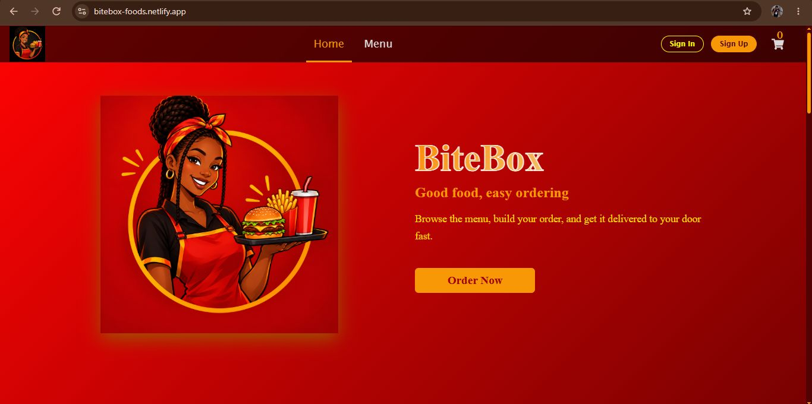

**Menu Items**

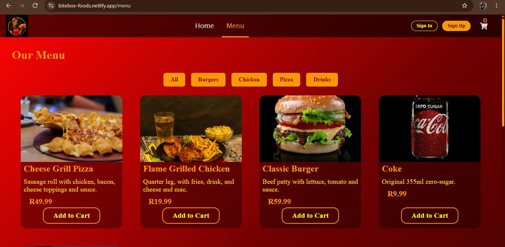

**Shopping Cart**

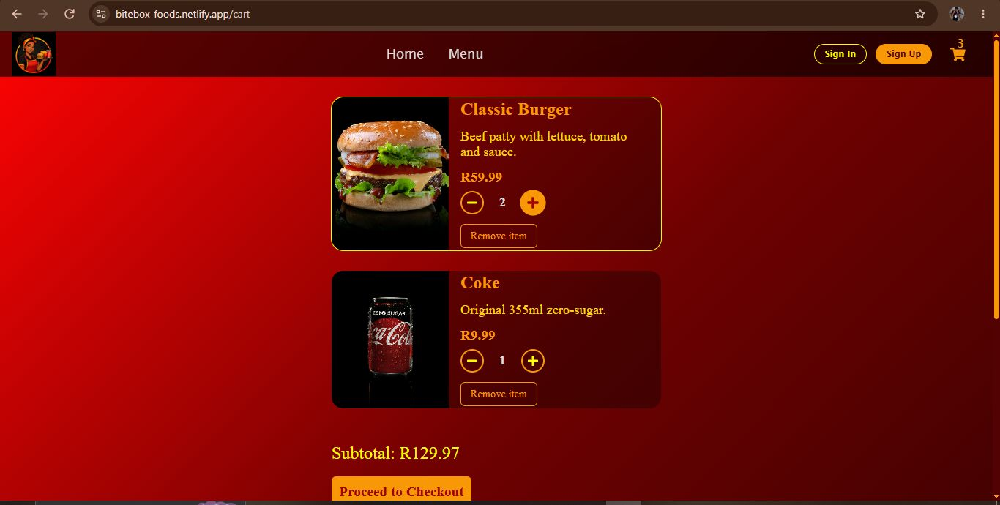

**Customer Login**

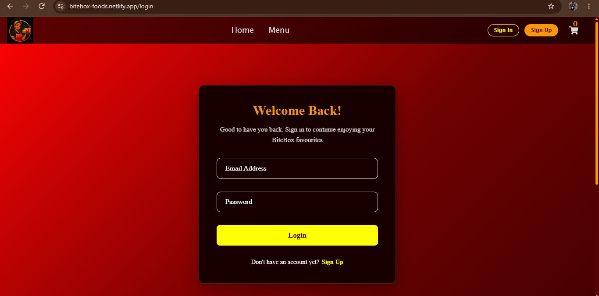

**Delivery Checkout**

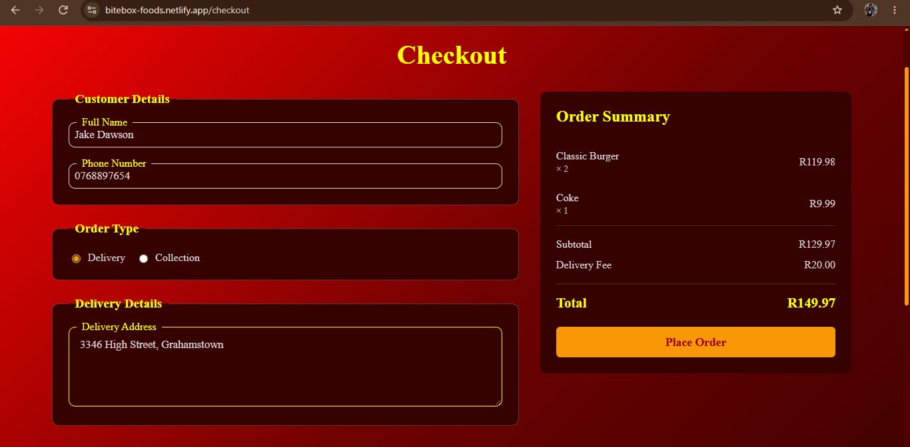

**Collection Checkout**

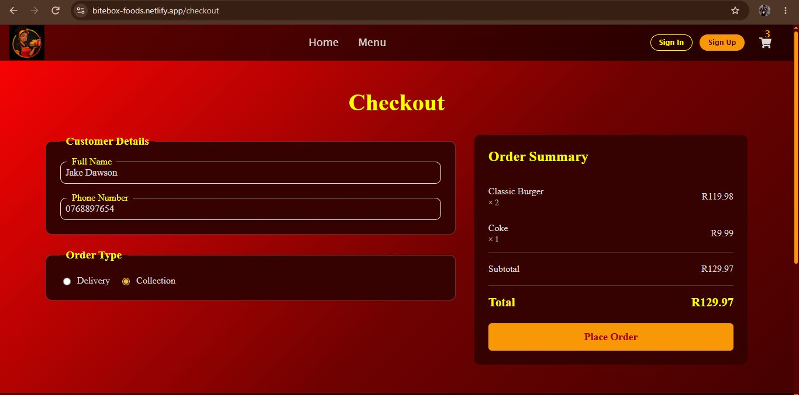

**Order Details**

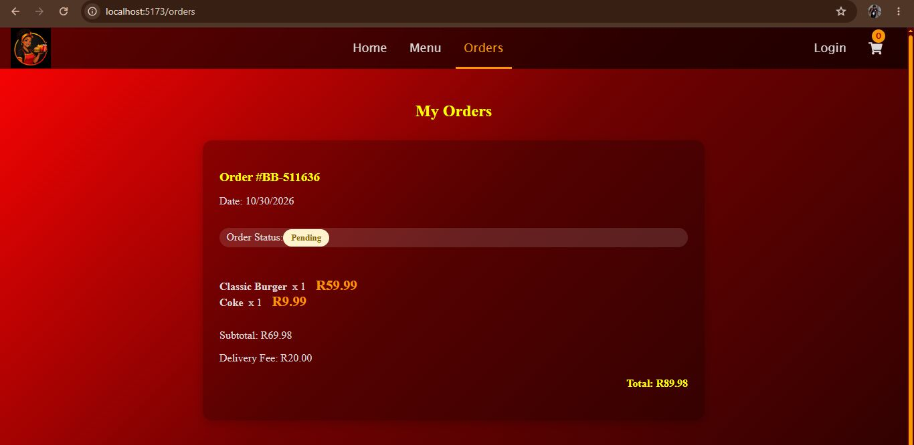

**Order Status Tracking**

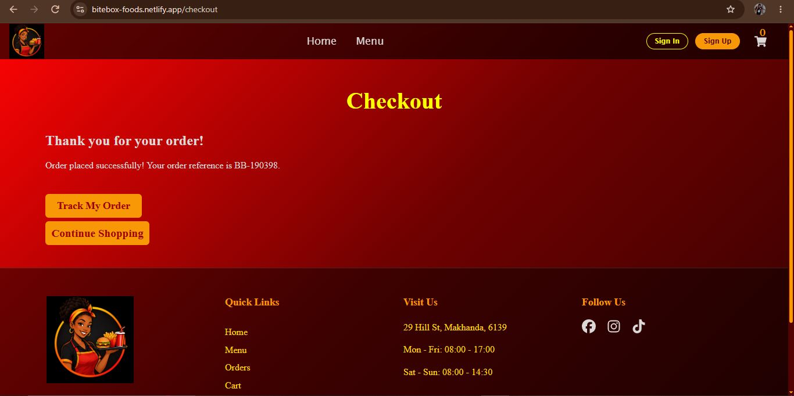

### Admin Dashboard

**Dashboard Overview**

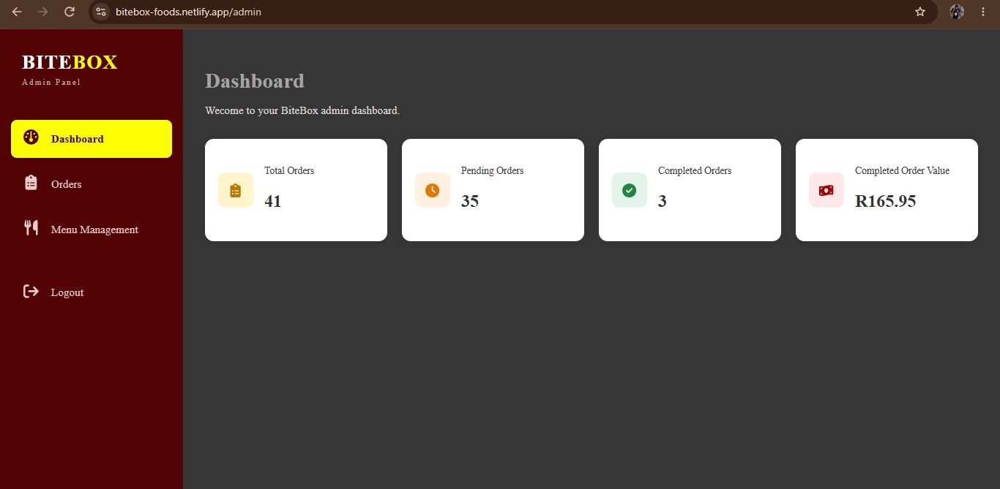

**Menu Management**

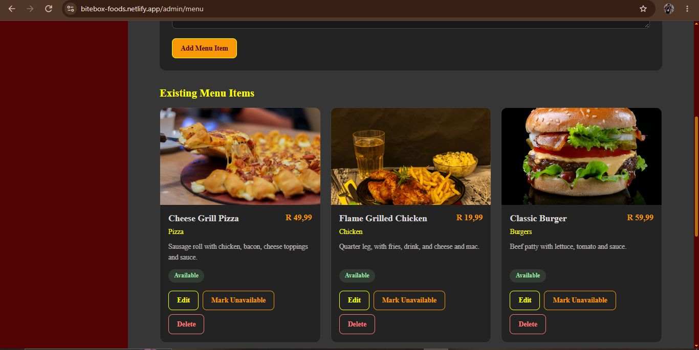

**Order Management**

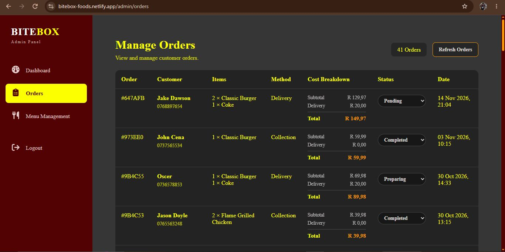

## Features

### Customer Features

- Browse available menu items.
- Add meals to a shopping cart and update quantities.
- Customer registration and login.
- Guest checkout without creating an account.
- Choose between delivery and collection.
- View personal order history.
- Track orders using an order tracking link and token.
- Check menu item availability.

### Admin Features

- Secure administrator authentication.
- View dashboard statistics.
- Add, edit and delete menu items.
- Manage menu item availability.
- View and manage customer orders.
- Update order statuses.

## Technologies Used

### Frontend

- React
- JavaScript
- Vite
- CSS
- React Router
- Framer Motion

### Backend

- Node.js
- Express.js
- MongoDB
- Mongoose
- JSON Web Tokens (JWT)
- bcryptjs

### Deployment and Services

- Netlify – Frontend hosting
- Render – Backend hosting
- MongoDB Atlas – Database hosting

## Running the Project Locally

### Prerequisites

- Node.js and npm
- MongoDB Atlas account or a local MongoDB instance
- Git

### 1. Clone the repository

```bash
git clone https://github.com/OMagwala/BiteBox---restaurant-ordering-system.git
```

### 2. Navigate to the project directory

```bash
cd BiteBox---restaurant-ordering-system
```

### 3. Install frontend dependencies

```bash
npm install
```

### 4. Install backend dependencies

```bash
cd server
npm install
```

### 5. Configure environment variables

Create a `.env` file inside the `server` directory:

```env
PORT=5000
MONGO_URI=your_mongodb_connection_string
JWT_SECRET=your_jwt_secret
```

Create another `.env` file in the project root:

```env
VITE_API_URL=http://localhost:5000/api
```

Replace the placeholder values with your own MongoDB connection string and JWT secret.

### 6. Start the backend

From the `server` directory, run:

```bash
npm run dev
```

### 7. Start the frontend

Open another terminal in the project root and run:

```bash
npm run dev
```

The application will be available at:

`http://localhost:5173`

## Project Status

BiteBox is deployed as a portfolio project demonstrating full-stack web development, REST API integration, authentication, database management and responsive user interface design.

Payment gateway integration is not currently implemented.

## Author

Developed by **Olwethu Magwala**.
